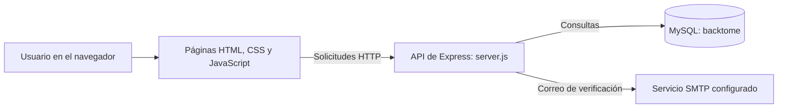

# BackToMe — Sistema de objetos perdidos y encontrados de la UDB

BackToMe es una aplicación web académica para que la comunidad de la Universidad Don Bosco registre objetos perdidos o encontrados, consulte publicaciones y coordine la recuperación de pertenencias.

## Equipo

- **Andrea Michelle Jiménez Aguilar** — JA262091
- **Kimberly Alexandra Rivera López** — RL261989

## Qué resuelve

Los reportes de objetos suelen quedar dispersos y es difícil identificar a quién contactar. BackToMe concentra esos avisos en un mismo sitio. En cada publicación se pueden indicar el tipo de reporte (objeto perdido o encontrado), nombre, categoría, descripción, fecha aproximada, fotografía y una ubicación escrita por quien publica. La ubicación libre permite describir sectores específicos de un campus amplio sin depender de una lista cerrada de lugares.

La versión implementada utiliza un único rol de usuario general. La propuesta inicial mencionaba roles diferenciados y una API de mapas; esos elementos no forman parte de esta versión. La geolocalización se describe mediante texto ingresado por el usuario.

## Funciones del sistema

### Cuenta y acceso

- Registro e inicio de sesión.
- Verificación del correo electrónico mediante un enlace enviado por correo.
- Gestión de sesión para las operaciones autenticadas.
- Edición del nombre desde el perfil.

### Reportes de objetos

- Publicación de objetos perdidos y encontrados.
- Captura de nombre, categoría, descripción, fecha aproximada, fotografía y ubicación personalizada.
- Consulta y búsqueda de publicaciones para ayudar a identificar objetos.
- Edición y eliminación de publicaciones propias.

### Recuperación y comunicación

- Envío y gestión de solicitudes relacionadas con publicaciones.
- Conversaciones entre usuarios participantes y envío de mensajes asociados a ellas.

## Recorrido principal

1. La persona crea una cuenta y verifica su correo.
2. Inicia sesión y publica un objeto perdido o encontrado, describiendo sus características y el lugar con el mayor detalle posible.
3. Otra persona consulta las publicaciones y, si reconoce un objeto, envía una solicitud.
4. Las personas involucradas pueden continuar la coordinación mediante la conversación asociada.
5. Quien publicó puede administrar sus publicaciones desde su perfil.

## Organización técnica

La aplicación está dividida en una interfaz web y una API local:

- **Interfaz:** páginas HTML, estilos CSS y módulos JavaScript en el navegador. Los módulos envían solicitudes HTTP a la API.
- **Servidor:** `server.js`, construido con Node.js y Express. Expone las operaciones de cuenta, publicaciones, solicitudes y mensajes, y entrega o procesa datos de la aplicación.
- **Persistencia:** MySQL/MariaDB. El servidor usa `mysql2` para conectarse a la base `backtome`.
- **Correo:** Nodemailer transmite los mensajes de verificación usando la configuración SMTP definida localmente.
- **Configuración:** `dotenv` carga las variables del archivo `.env`; `cors` permite las solicitudes entre la interfaz y el servidor durante el desarrollo.



## Modelo de datos

La base incluye tablas agrupadas por responsabilidad:

| Tabla | Propósito |
|---|---|
| `usuarios` | Datos de las cuentas y perfil de usuario. |
| `verificaciones_correo` | Información para completar la verificación de una cuenta por correo. |
| `objetos` | Publicaciones de objetos perdidos o encontrados. |
| `solicitudes` | Solicitudes para recuperar o consultar una publicación. |
| `conversaciones` | Conversaciones asociadas a la comunicación entre usuarios. |
| `participantes_conversacion` | Usuarios que forman parte de cada conversación. |
| `mensajes` | Mensajes enviados dentro de una conversación. |

Los scripts de `database/` contienen las migraciones SQL usadas para preparar o ampliar el esquema.

## Tecnologías

- HTML5, CSS3 y JavaScript
- Node.js y Express
- MySQL/MariaDB mediante `mysql2`
- Nodemailer para correo SMTP
- `dotenv` para variables de entorno
- `cors` para comunicación local entre frontend y API
- Git y GitHub para control de versiones

## Estructura del repositorio

```text
.
├── css/
│   ├── acceso.css
│   ├── app.css
│   └── estilos.css
├── database/
│   ├── auth-migration.sql
│   └── contenido-migration.sql
├── imagenes.img/
│   └── logo-udb.png
├── js/
│   ├── app.js
│   ├── auth.js
│   ├── dashboard.js
│   ├── login.js
│   ├── objetos.js
│   ├── publicar.js
│   ├── registro.js
│   ├── solicitudes.js
│   ├── theme.js
│   └── validaciones.js
├── dashboard.html
├── index.html
├── login.html
├── objetos.html
├── publicar.html
├── registro.html
├── solicitudes.html
├── server.js
├── package.json
├── package-lock.json
├── .env.example
└── README.md
```

## Requisitos para ejecutarlo

- Node.js y npm instalados.
- MySQL o MariaDB en ejecución.
- Credenciales de una cuenta de correo con SMTP habilitado para probar la verificación por correo. Para Gmail se necesita una contraseña de aplicación.

## Configuración local

1. Clona el repositorio y abre una terminal en la carpeta del proyecto.
2. Instala las dependencias:

   ```bash
   npm install
   ```

3. Crea una base de datos llamada `backtome` en MySQL/MariaDB, con codificación `utf8mb4`.
4. En phpMyAdmin, selecciona `backtome` e importa los scripts de `database/` en este orden:
   - `auth-migration.sql`
   - `contenido-migration.sql`
5. Copia `.env.example` como `.env` y completa allí las variables de conexión a MySQL y de correo. Usa los nombres que aparecen en la plantilla; las credenciales son propias de cada instalación.
6. Inicia la API desde la carpeta del proyecto:

   ```bash
   node server.js
   ```

7. Abre `index.html` en el navegador. Con el servidor activo, la ruta `http://localhost:3000/api/db-test` permite comprobar la conexión de la API con la base.

## Responsabilidad de cada integrante

- **Andrea:** trabajó en la interfaz inicial de BackToMe y en su presentación visual, incluyendo las pantallas y recursos gráficos de la primera etapa.
- **Kimberly:** integró la interfaz con la API y MySQL, e implementó el flujo de registro y verificación por correo, la publicación con ubicación personalizada, la edición del perfil y de publicaciones propias, y las funciones de solicitudes y chat. También documentó la estructura y configuración del proyecto.

## Estado

Este repositorio corresponde a un prototipo académico en desarrollo. La conexión de correo depende de la configuración SMTP local; cada integrante debe crear su propio `.env`. La API externa de mapas mencionada en el planteamiento inicial no está integrada en esta versión.
